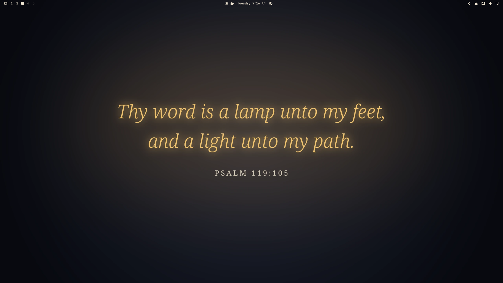
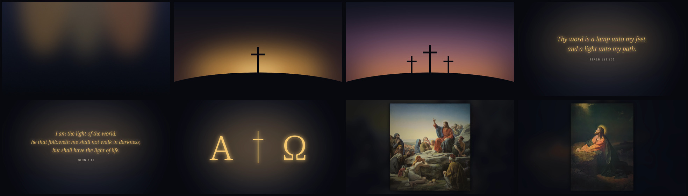
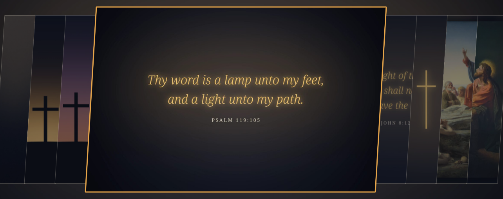
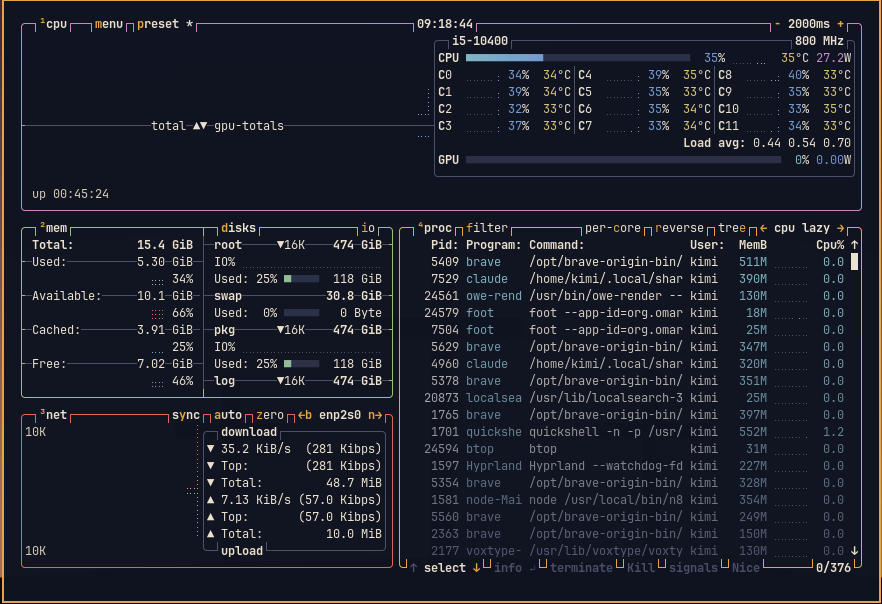

# Worship Night

A dark Omarchy theme inspired by worship nights: a deep navy room, warm amber and candlelight gold stage lights, and wallpapers centered on Jesus and Scripture.



## Install

```bash
omarchy theme install https://github.com/kcayboen/omarchy-worship-night-theme
```

Cycle wallpapers with `Super + Ctrl + Space` or `omarchy theme bg next`.

## Palette


| Role | Hex |
|---|---|
| Background | `#0f1320` |
| Lighter background | `#1c2233` |
| Selection | `#2a3048` |
| Accent (amber) | `#e8a64a` |
| Gold | `#f2c46d` |
| Orange | `#e8924a` |
| Red | `#e0645c` |
| Green | `#9cbf7a` |
| Cyan | `#7fb8c4` |
| Blue | `#6f8fd8` |
| Magenta | `#c48ac9` |
| Foreground | `#ece3d0` |

Icons use `Yaru-yellow-dark`. Terminal, Hyprland, btop, Neovim and VS Code colors are generated by Omarchy from `colors.toml`.

## Wallpapers



1. Stage Lights
2. Cross at Dawn
3. Three Crosses
4. Psalm 119:105
5. John 8:12
6. Alpha and Omega
7. The Sermon on the Mount, Carl Bloch (1877)
8. Christ in Gethsemane, Heinrich Hofmann (1886)

Wallpapers 1 to 6 are made with ImageMagick. Rebuild or tweak them with `scripts/make-wallpapers.sh`. `scripts/frame-paintings.sh` downloads and frames 7 and 8.

## Screenshots





## Credits

- *The Sermon on the Mount* by Carl Bloch (1877) and *Christ in Gethsemane* by Heinrich Hofmann (1886), public domain, via [Wikimedia Commons](https://commons.wikimedia.org/).
- Scripture quotations are from the King James Version (public domain).

## License

Theme files and scripts are MIT licensed. The paintings and Scripture text are public domain.
